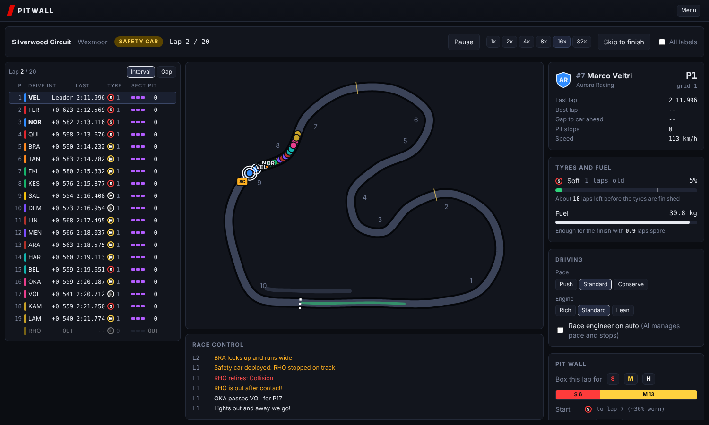
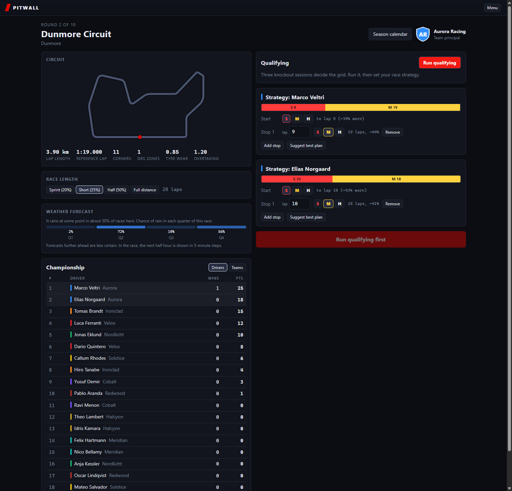
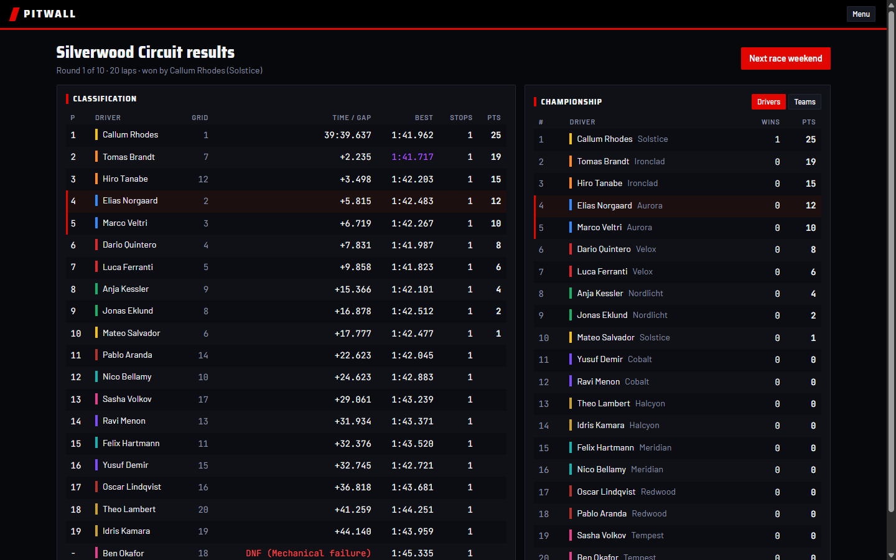
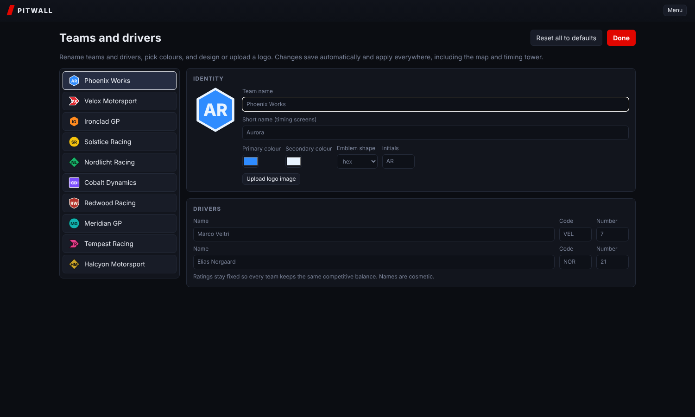
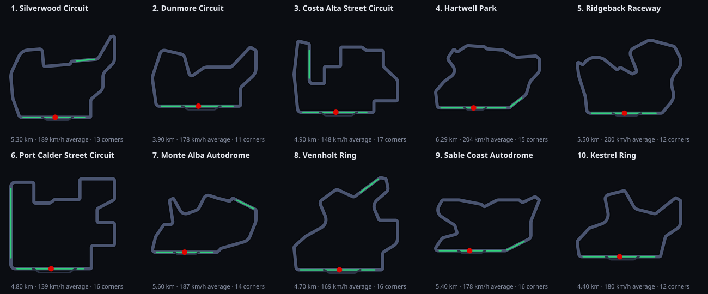

# Pitwall

A browser-based Formula-style team manager. You run a team through a season: pick a strategy, qualify, then manage tyres, fuel, engine modes and pit stops live from the pit wall while every car circulates a real-time map of the circuit.

Everything in it is fictional (teams, drivers, circuits), and everything is editable: team names, short names, colours, driver names, codes, numbers, and logos (generated emblems or your own uploaded image).



| Weekend planning | Results | Team editor |
| --- | --- | --- |
|  |  |  |

## What is in the game

- **Live track map** with a marker per car, DRS zones, pit lane, sector lines, corner numbers and the safety car.
- **Timing tower** with interval or gap to leader, last lap (purple for fastest, green for personal best), tyre compound and age, sector colours and pit stops.
- **Pit wall** for your two cars: pace and engine modes, pit-now with compound choice and a projected rejoin position, an editable stop plan with tyre-wear forecasts and warnings, tyre-life and fuel-margin estimates, and an optional AI race engineer.
- **Key moments pause the race**: when the safety car comes out, one of your cars is damaged, rain starts, or the conditions turn in favour of another tyre, the game stops and asks for your pit call (this can be turned off).
- **Weather**: rain that comes and goes, a racing line that dries before the rest of the track, intermediate and full wet tyres, and a forecast with honest uncertainty, by quarter of the race before the start and in 5-minute steps during it. Rivals react to the rain they can see; the forecast is your edge.
- **Weekend flow**: Q1/Q2/Q3 knockout qualifying, strategy planning, the race, classification with points, and a drivers' and constructors' championship over a ten-round season. Progress is saved in the browser; a season started before the calendar grew keeps its original four rounds.
- **Ten fictional circuits**, each with its own problem: a fast power circuit, two street circuits where passing is hard, a tyre-eater, a 79-lap short track and more. A calendar screen shows each round's character and how your finished rounds went.


- **Speed control** from 1x to 32x, pause, and skip to the flag.

## The simulation

The engine is plain TypeScript with no UI or browser dependencies, deterministic for a given seed, and runs a full 58-lap race in well under a second headless.

- **Circuits** are closed splines resampled every 5 m. A speed profile comes from lateral-grip limits plus acceleration and braking passes, then is scaled to a target lap time. DRS zones, corners, sectors and a pit lane are derived from the geometry.
- **Pace** combines car ratings weighted by circuit, driver ratings, per-race form, fuel load, tyre compound, wear and warm-up, engine and pace modes, track rubbering, dirty air and DRS.
- **Tyres** have three slick compounds with linear degradation and a quadratic cliff past 72% wear, plus intermediates and full wets whose pace depends on how wet the racing line is.
- **Weather** is a rain timeline decided with the round. Track wetness rises with rain and dries fastest on the racing line. The forecast turns a noisy reading of each window into a probability with Bayes' rule, and its reliability is measured: stated chances come true within a few points of what they say.
- **Racing**: overtakes are probabilistic and depend on pace delta, DRS, circuit difficulty and driver racecraft. Incidents, mechanical failures and punctures trigger a safety car that bunches the field.
- **Pit stops** are a small state machine (pit lane at 80 km/h, stationary time from crew rating, double-stack queueing). A one-compound race costs 30 s, as in the real rules.
- **AI strategy** enumerates stop counts and compound orders, allocates stint lengths by marginal cost, and adds jitter so rivals do not all pit together. In the race, AI drivers push when they have a car to catch or defend from, and save tyres when nobody is within reach.
- **Calibrated** against real-race figures over 300 headless races: about 63 overtakes, 1 safety car and 1.7 retirements per full race, pole converted about half the time. The table is in [docs/DESIGN.md](docs/DESIGN.md#calibration).
- **Gaps** come from per-car 10 m checkpoint times, so intervals are real time gaps rather than distance estimates.

See [docs/DESIGN.md](docs/DESIGN.md) for the architecture, the calibration targets, and the roadmap.

## Run it

Requires Node 22.18 or newer.

```bash
npm install
npm run dev        # start the game at http://localhost:5173
npm test           # engine and season unit tests (node:test, no extra dependencies)
npm run build      # typecheck and production build into dist/
npm run sim -- --track silverwood --seed 3   # run a whole race headless and print the result
npm run calibrate -- --seeds 30               # 300 races, averages for the calibration table in docs/DESIGN.md
npm run calibrate -- --seeds 30 --weather     # the same, with each circuit's chance of rain as in the game
npm run circuits                              # circuit numbers, and redraw docs/circuits.svg
```

Pushing to `main` runs tests and the build, then deploys `dist/` to GitHub Pages (enable Pages with the "GitHub Actions" source in the repository settings).

## Project layout

```
src/engine/   simulation (no UI imports): track, tyres, race, strategy, qualifying, scoring
src/data/     fictional teams, drivers and circuits
src/state/    season, standings and localStorage persistence
src/ui/       React components: track map, timing tower, pit wall, hub, results, team editor
scripts/      headless race runner and circuit inspector
```

## Tech

TypeScript (strict), React 19, Vite 7, Node's built-in test runner, ESLint 9, GitHub Actions.

## Status

The core loop (strategy, qualifying, race, standings) over a ten-round calendar is playable. Planned next: R&D and budget, driver contracts and sponsors. All names are invented and not affiliated with any real championship.
